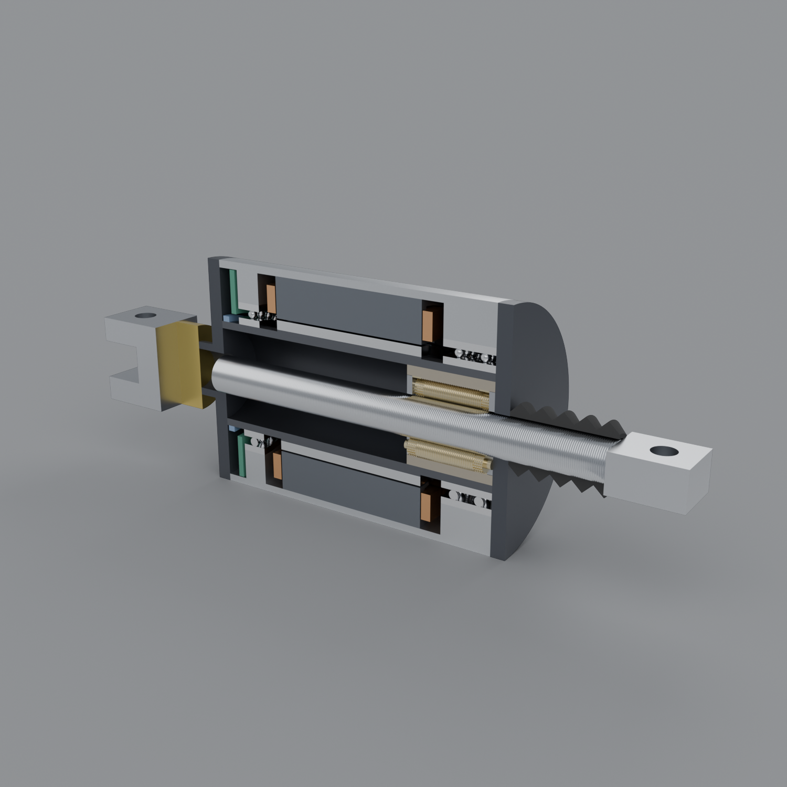
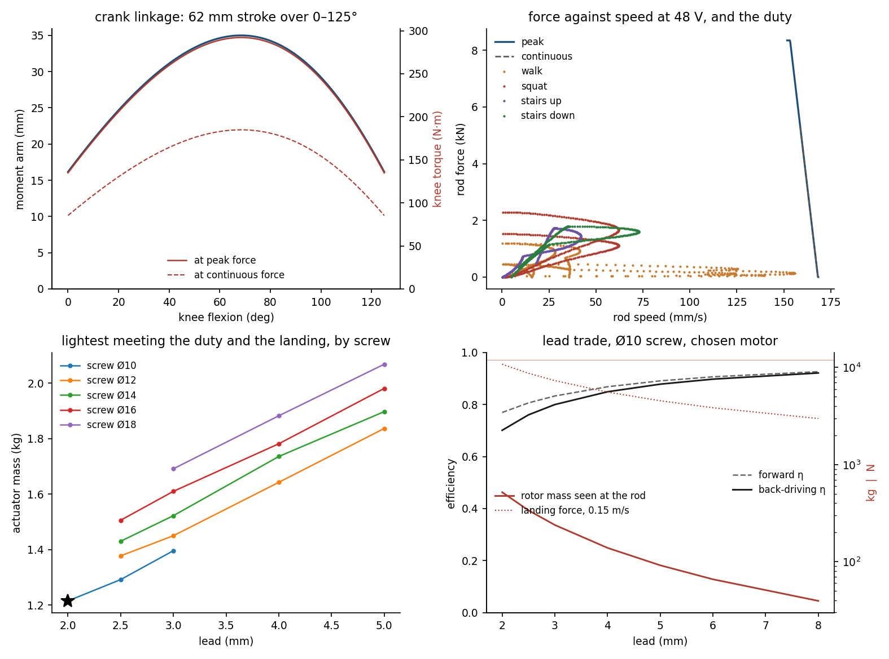
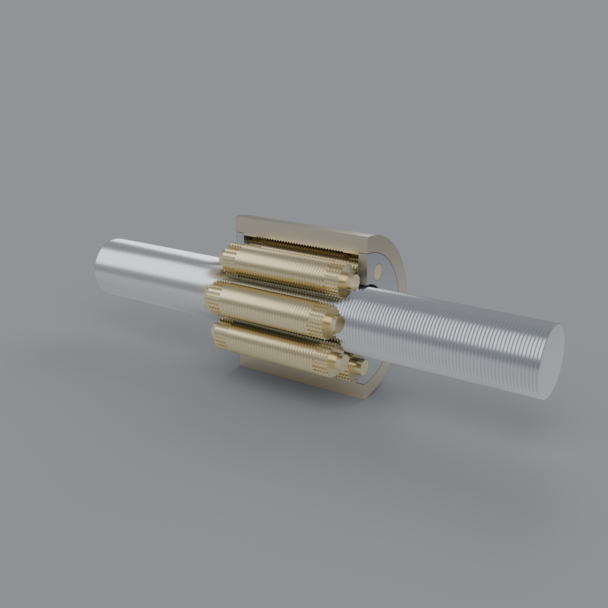
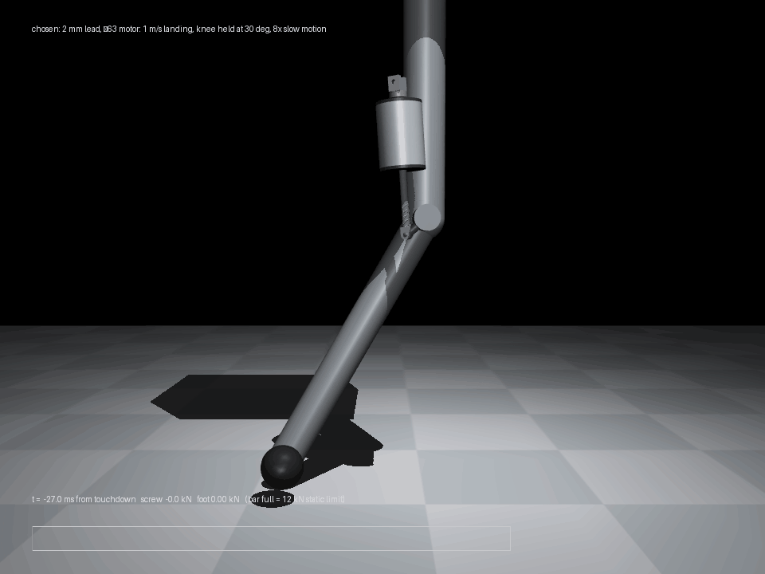
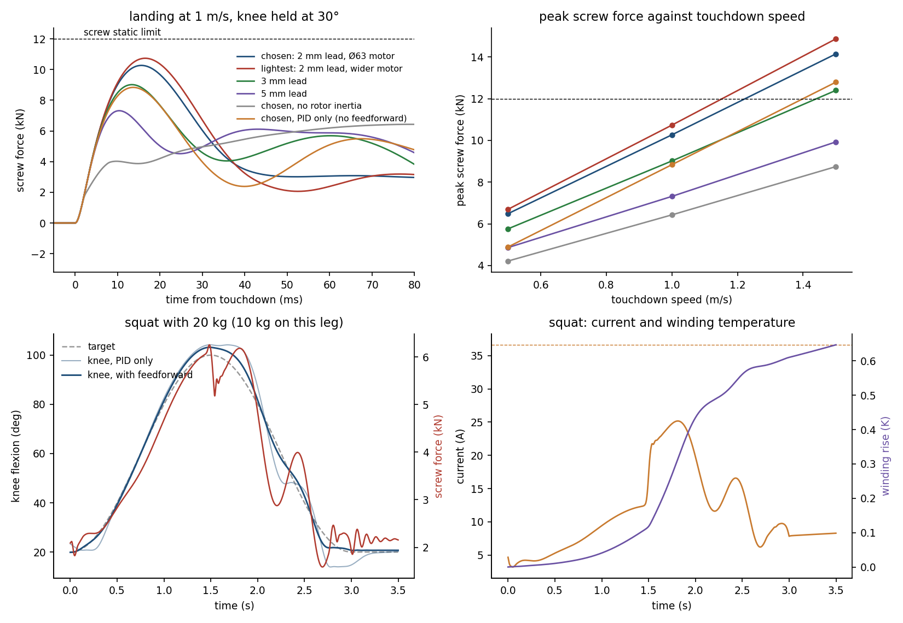

# Roller-screw linear actuator (Optimus-style, 8 kN knee class)

A linear actuator in the layout Tesla showed for Optimus. A frameless hollow brushless
motor turns the nut of a planetary roller screw, and the screw itself is the output rod.
The design is sized here for the 8 kN class, driving a knee through a short crank, and
the requirements come from a day of knee duty rather than a datasheet.

Nothing here has been built.

| file | what |
|---|---|
| `design.py` | sizing: screw kinematics and contact, motor, linkage, duty, life, landing; sweep and choice (`make rollerscrew`) |
| `cad.py` | the chosen design as an assembly: STEP, STLs, interference checks, per-solid part checks, CAD mass against the sizing (`make rollerscrew-cad`) |
| `render.py` | Blender renders: half-section, roller screw alone (`make rollerscrew-render`) |
| `sim.py` | MuJoCo leg with the actuator in its knee: statics check, landings, loaded squat (`make rollerscrew-sim-demo`); interactive viewer (`make rollerscrew-sim`); `make rollerscrew-sim-selftest` |
| `out/design.json` | every number below, plus the axial stations `cad.py` builds from |



## The layout

```
rear pin ─ load cell ─ rear cap ─ encoder ─ bearing ─ [ stator / rotor ] ─ thrust pair ─ front cap ─ boot ─ rod eye
                                               └ rotor hub carries the nut ┘
screw (the rod) runs through the hollow rotor; it does not turn, the nut does
```

- **Load path:** rod eye → screw → rollers → nut → rotor hub → front bearing pair →
  housing → rear cap → load cell → rear pin. The force sensor sees the rod force.
- **Rotor:** turns the nut. The rollers orbit at d_n/(d_s+d_n) of nut speed.
- **Screw:** prevented from turning by the two pinned ends.
- **Retracting:** the screw's tail runs back into the rotor bore.
- **Extending:** the threads leave through a wiper in the front cap, under a boot.

## Sources and what is assumed

What comes from the outside world:

- **Layout:** frameless BLDC around a planetary roller screw, short-stroke linkages, about
  50 mm of visible stroke, and the 500 / 3,900 / 8,000 N force classes. Sources:
  [Firgelli](https://www.firgelliauto.com/blogs/actuators/how-do-tesla-bot-actuators-actually-work)
  and [humanoid.guide](https://humanoid.guide/?p=20588). Both are secondary; I found no
  primary Tesla figures for mass, lead or stroke and use none.
- **Robot mass:** 57 kg, the planned Optimus mass on
  [Wikipedia](https://en.wikipedia.org/wiki/Optimus_(robot)), citing Motor Authority (2021).
- **Screw dynamic load ratings:** a power-law fit
  (Ca = 0.066 · d^2.09 · lead^0.19 kN) to five catalogue values (15×5, 15×8, 21×5, 21×8,
  21×10). humanoid.guide quotes them from the Ewellix catalogue; I have not checked them
  against that catalogue.

Everything else is assumed, and stated where it is used in `design.py`. The ones that
move the answer:

| assumption | value | what it decides |
|---|---|---|
| gap shear at peak current (saturation stand-in) | 40 kPa | peak force, so motor size |
| winding limit, ambient, heat path to the limb | 140 °C, 40 °C, h = 40 W/m²K + 0.4 K/W | continuous force |
| screw shock factor | 1.5 × 8 kN | screw diameter (static contact) |
| landing: rod speed change, series stiffness | 0.15 m/s into 10 N/µm | which lead and motor diameter survive |
| thread load sharing along the nut | peak 1.3 × mean | contact pressure |
| efficiency friction coefficient | 0.019 (gives about 0.85 at 15×5) | forward and back-driving efficiency |
| duty, per knee per day | 10 km walking, 200 squats to 100° with 20 kg, 30 floors up and down | life, thermal rms, speed |

The gait, squat and stair profiles are synthetic: knee angle and moment shapes built by
hand to look like human data (stance extensor peak 0.5 N·m/kg, stairs about 1 N·m/kg).
They are not digitised from a dataset.

## Result: the chosen design

| | |
|---|---|
| screw | Ø10 mm, 2 mm lead (4 starts × 0.5 mm pitch), 7 rollers Ø5 mm, nut Ø20 mm pitch, 16 mm threaded nut (32 threads engaged per roller side) |
| sync gears | module 0.25; 20 teeth on each roller, 80 on each ring gear. Each roller's thread is indexed to its teeth: phases 0, 0.57, 0.14, 0.71, 0.29, 0.86, 0.43 of a pitch |
| motor | 12 slots / 14 poles, Ø63 mm × 44 mm stack, 8 turns per coil, 48 V |
| peak force | 8.3 kN at 20 A/mm² (37 A), about 25 s from 40 K below the winding limit, 64 s from ambient |
| continuous force | 5.3 kN (21 A, 67 W copper loss) |
| speed | 168 mm/s no load, 152 mm/s at peak force |
| efficiency | 0.77 forward, 0.70 back-driven; 220 N of rod force to back-drive the seal and preload drag |
| stroke | 62 mm over 0–125° knee flexion; pins 153 to 215 mm apart |
| body | Ø63 × 91 mm |
| mass | 1.21 kg: stator 291 g, copper 177, housing 240, rotor + magnets + hub 211, screw 70, nut + rollers 60, bearings 66, extras 100 |
| screw contact | 2.7 GPa at 8 kN, 3.1 GPa at 12 kN (limit taken as 4.0) |
| screw life | L10 about 31 years of the duty day (cubic-mean load 670 N, 270,000 nut revolutions a day) |
| rotor inertia seen at the rod | 520 kg; landing force 10.8 kN against the 12 kN limit (one-mass estimate); 10.3 kN in the MuJoCo leg at 1 m/s touchdown |



## What the numbers say

1. **The duty is far below the rating.**
   - Walking, stairs and the loaded squat peak at 2.3 kN on the rod, and the day's rms is
     0.67 kN.
   - The 8 kN class is about 3.5× the daily peak and 12× the rms. It is there for jumps,
     falls and recoveries, not for carrying a payload.
   - So the continuous rating (5.3 kN) is not close to binding. Peak force, set by motor
     saturation, sizes the motor.
2. **Weight alone picks the shortest lead and a fat motor, and a landing rules that out.**
   - Torque needed falls with lead, so the lightest design overall is a 2 mm lead with a
     Ø69 mm motor at 1.206 kg.
   - Its rotor, seen through a 2 mm lead, acts like 650 kg on the rod. A rod forced to
     0.15 m/s through 10 N/µm then puts 12.1 kN on the screw, just past its static limit.
   - The lightest design that survives is the Ø63 mm motor at 1.215 kg, 9 g heavier.
     Inertia rises with the rotor radius squared, so the narrower motor reflects less
     (520 kg).
   - Lightest per lead that survives the landing:

     | lead | motor | mass | inertia at rod | landing | back-drive drag |
     |---|---|---|---|---|---|
     | 2 mm | Ø63 × 44 | 1.21 kg | 520 kg | 10.8 kN | 224 N |
     | 2.5 mm | Ø65 × 44 | 1.29 kg | 385 kg | 9.3 kN | 165 N |
     | 3 mm | Ø72 × 38 | 1.40 kg | 383 kg | 9.3 kN | 131 N |
     | 4 mm | Ø76 × 42 (Ø12 screw) | 1.64 kg | 318 kg | 8.5 kN | 96 N |
     | 5 mm | Ø70 × 66 (Ø12 screw) | 1.84 kg | 196 kg | 6.6 kN | 74 N |

   - A 3 mm lead costs 190 g and gives back-drive efficiency 0.80 instead of 0.70, 40% less
     drag, and a landing force of 9.3 kN instead of 10.8.
   - For force control through the load cell, 3 mm is the better trade. The landing
     assumption is the least certain number here, and it decides this choice.
3. **Static contact sets the screw size, not life.**
   - At Ø10 mm the screw reaches 3.1 GPa under the 12 kN shock, against a 4 GPa limit.
   - Its L10 is decades of the duty day.
   - Bearing life is not modelled. The front pair carries the full rod force and is the
     likelier wear part (next steps).
4. **The Hertz model agrees with the catalogue to within its proportions.** Each
   catalogue screw sees 3.3 to 4.8 GPa at its own Ca in this model. The spread follows
   the roller count each size gets here, which the catalogue does not state.

## CAD

`cad.py` builds 21 part types from the same numbers, with the rod retracted, and writes
`out/cad/assembly.step`. It runs three kinds of check, and the build fails if any fails.

- **Interference:** 26 part pairs checked for shared volume, all clear. The screw, rollers
  and nut meet flank to flank with 0.03 mm clearance, and the roller gears sit in the ring
  gears' tooth spaces.
- **Each solid** (all 162, counting every magnet, coil and bearing ball) is exported,
  reloaded in trimesh, and checked to be watertight, one body, and inside the actuator's
  envelope. Two things it caught:
  - OCC's sphere primitive tessellates into three loose shells, so the bearing balls are
    built with small flats at the poles.
  - The rod-eye block ran 1 mm past the rounded end of the eye.
- **Mass:** each part's CAD volume at material density is compared with the sizing
  model's budget line.
  - It found the aluminium webs that carry the bearings, about 75 g, which the sizing had
    left out. They are now in `design.py`, which put the design at 1.21 kg rather than
    1.14. The choice did not change.
  - Copper still reads 25% high, because the CAD coils are solid copper blocks with no
    allowance for fill.



Stand-ins in the CAD:

- **Threads** are rings of revolution phased to mesh, not helices.
- **Roller gear teeth** keep the thread profile, as in a real planetary roller screw, so
  they still mesh with the screw. Their tooth form is trapezoidal, not involute.
- **Coil sides** are rectangular. They fill less of the tapered slot than the 45% fill
  the sizing assumes, so read the copper mass as the sizing's, not the CAD's.
- **Bearings** have races and balls but no cage. No fasteners, leads or seals beyond the
  wiper bore.

## Simulation

`sim.py` puts the chosen actuator in one leg of the 57 kg robot in MuJoCo.

- **Leg:** a hip mass on a vertical slide carries half the robot. The thigh hangs from it,
  with a knee hinge, a shank, and a foot on a padded, frictionless floor.
- **Actuator:** pinned to the thigh at the linkage's base point, with its rod pinned to the
  shank's crank. A site-to-site connect closes the loop.
- **Inside the actuator**, everything comes from `design.py`:
  - A series spring (10 N/µm) stands for the bearings, housing and load cell. The force in
    it is what the load cell reads and what the screw carries.
  - The rotor and nut inertia sit on the drive slide, as the 520 kg the rod sees.
  - The screw's forward and back-driving efficiency and its seal drag are a load-dependent
    friction budget, set each step by the repo's `friction/FrictionUpdater`.
  - The motor is current-limited at 37 A and voltage-limited by back-EMF at 48 V, with
    torque capped at the saturation torque. Winding temperature integrates the copper loss
    through the sizing's lumped thermal resistance.
- **Controller:** a PID on the rotor encoder. On top of it is a feedforward of the leg's
  static rod force at the target angle, divided by the forward efficiency when lifting
  and multiplied by the back-drive efficiency when lowering. The feedforward is applied
  only while the foot is loaded.
- **Visuals:** the CAD meshes. The masses come from the sizing.





What it shows:

1. **The model agrees with hand statics.** Held at 20°, 45°, 70° and 90°, the screw
   force matches statics on the shank to within 0.4–0.75%. The linkage loop stays closed
   to under a micron.
2. **Landing, with the knee held at 30°.** Peak screw force against touchdown speed:

   | | 0.5 m/s | 1.0 m/s | 1.5 m/s |
   |---|---|---|---|
   | chosen, 2 mm lead, Ø63 | 6.5 kN | 10.3 kN | 14.2 kN |
   | lightest, 2 mm lead, Ø69 | 6.7 | 10.7 | 14.9 |
   | 3 mm lead | 5.8 | 9.0 | 12.4 |
   | 5 mm lead | 4.9 | 7.3 | 9.9 |
   | chosen with no rotor inertia | 4.2 | 6.4 | 8.7 |

   - The chosen design survives a 1 m/s landing at 86% of the 12 kN static limit. At
     1.5 m/s it does not; only the 5 mm lead does.
   - The rotor's inertia adds about 4 kN at 1 m/s. The lead ranking matches `design.py`.
   - The rod's speed change at 1 m/s touchdown is 0.09 m/s, smaller than the 0.15 m/s the
     sizing assumed. But the static load and the controller add to the peak, so the
     one-mass estimate (10.8 kN) lands close to the simulated 10.3 kN.
   - The foot pad matters. At 1 m/s, a pad of 1e5 N/m gives 8.0 kN and one of 1e6 N/m
     gives 11.7 kN.
   - **Caveat:** these are rigid-link numbers. Real links and joints add compliance, which
     lowers the peaks.
3. **Squat with 20 kg (10 kg on this leg), 20° → 100° → 20° in 3 s.** The screw's friction
   shows up in control:
   - Reversing at the bottom takes the screw from back-driven to driving. The motor force
     needed jumps from about 0.7× to 1.3× the load, a 3.6 kN window.
   - With a PID alone, the knee sticks at the bottom for about 0.3 s, then overshoots: 12°
     worst error, 31.5 A.
   - Gravity feedforward alone does not help.
   - Making the feedforward efficiency-aware brings the worst error to 5.3° and the peak to
     25 A, so the controller needs a model of the screw.
   - Winding rise per squat is 0.65 K.
4. **This leg's squat is harder than the sizing duty.**
   - Keeping the thigh upright means the foot slides forward. The ground force then acts
     on a 0.39 m lever at 100°, against the 0.12 m the sizing assumed for a human-like
     squat.
   - So it needs 5.2 kN static, and 6.3 kN peak, where the sizing assumed 2.3 kN.
   - Posture matters as much as payload. A robot that squats without leaning its trunk
     uses most of the 8 kN class.
5. **Load-cell feedforward needs a real force-loop design.** Feeding the measured rod
   force straight back (gain 0.9) went unstable in the squat: 21.7 kN at full current.
   As the body falls, the load cell reads less and the motor pushes less. The option is
   still in `Params`, off by default.

Interactive viewer (`make rollerscrew-sim`): sliders for the knee target and the payload.
Ctrl+right-drag on the hip pushes it, and the screw force, current and winding
temperature print once a second. It runs at a 1e-4 s step; the batch experiments use
2e-5 s.

## Not modelled, and next steps

- **Motor field solution.** The 40 kPa saturation cap decides peak force. Running
  `qdd-liquid/fea.py`'s nonlinear solver on this 12s/14p geometry would replace it.
- **Bearing life and stiffness.** Pick a catalogue thin-section angular contact pair for
  the Ø29.6 mm hub, check L10 on the same duty, and add its axial stiffness to the
  landing.
- **A fuller leg.** Add an ankle, a hip joint and a trunk that leans, so squat posture and
  landing match a real gait. Add link and joint compliance, which would lower the landing
  peaks.
- **A force loop.** Close the loop on the load cell properly, with a filter and gain
  designed against the rotor and pad modes, instead of the feedforward that went
  unstable.
- **Linkage.** A plain crank gives an arm that falls to 16 mm at both ends of travel. A
  four-bar could hold it nearer 30 mm and cut the peak force needed for the same knee
  torque.
- **The other classes.** The 500 N and 3.9 kN units are the same code with a different
  `F_PEAK` and duty.
