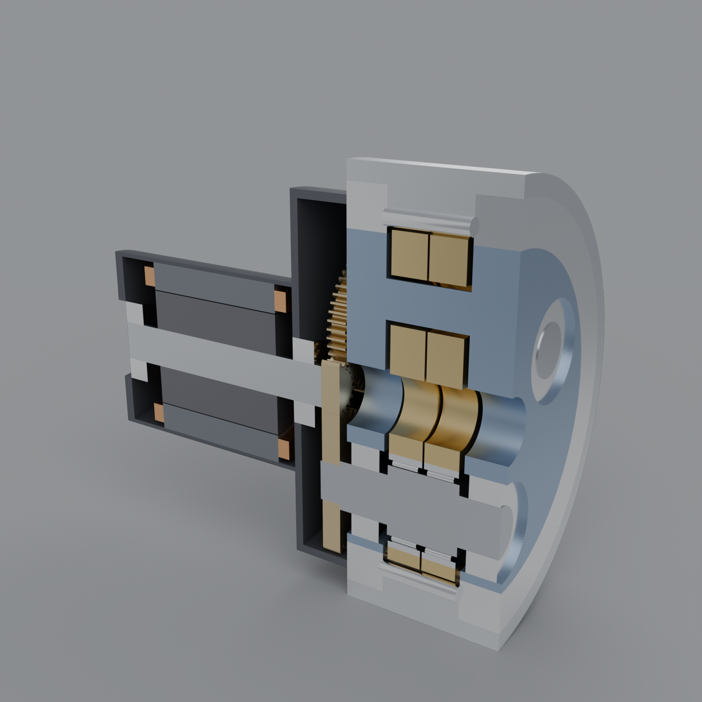
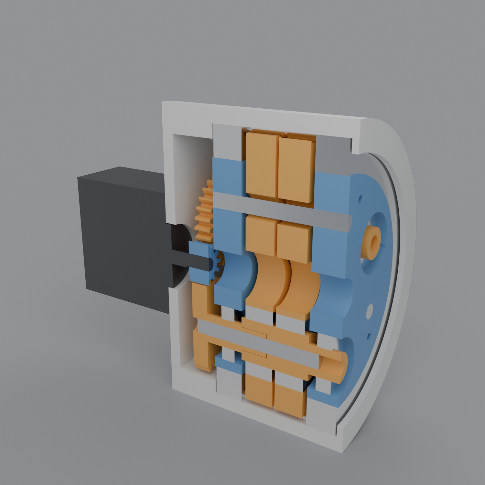
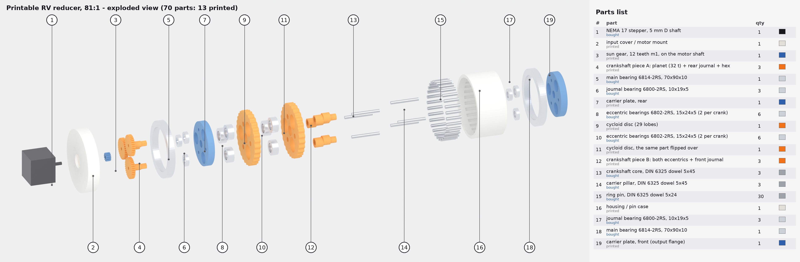
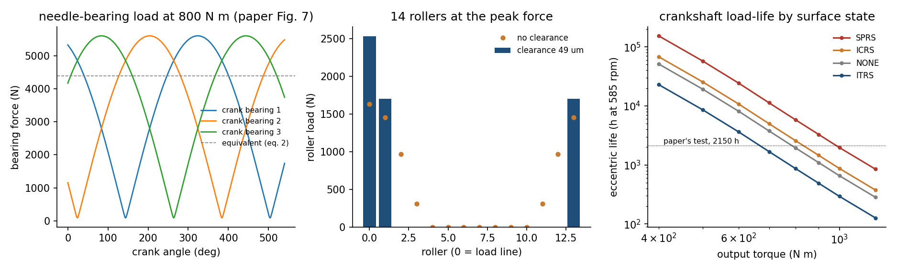
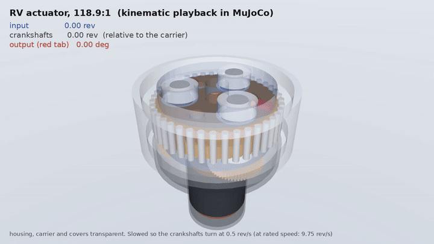

# RV reducer actuator, with crankshaft fatigue life

An RV (Rotate Vector) reducer actuator built around the reducer in

> Li, Shao, Tang, Ding & Zhou, "An Investigation of the Contact Fatigue Characteristics of
> an RV Reducer Crankshaft, Considering the Hardness Gradients and Initial Residual Stress",
> *Materials* 15 (2022) 7850, [doi:10.3390/ma15217850](https://doi.org/10.3390/ma15217850)

The paper's model carries the crankshaft's case hardening and surface treatment through to
its rolling-contact fatigue life. That is a manufacturing choice folded back into a service
life.

Nothing here has been built.

| file | what |
|---|---|
| `rcf.py` | the paper's crankshaft fatigue model rebuilt, and checked against its results (`make rv-rcf`) |
| `design.py` | reducer kinematics, gearing, needle-bearing and pin loads, crank life against torque and process, motor (`make rv`) |
| `cad.py` | the actuator as an assembly: interference checks on 29 part pairs, watertight and one body per solid (`make rv-cad`, about 9 min) |
| `render.py` | Blender half-section through a crankshaft (`make rv-render`) |
| `printed.py` | a 3D-printable version: printed parts, standard ball bearings and steel dowel pins only (`make rv-printed`) |
| `assemble_anim.py`, `assemble_blender.py` | assembly-and-run animation of the printable version (`make rv-assemble-video`) |
| `explode.py`, `explode_blender.py` | exploded drawing of the printable version with numbered balloons and a parts list (`make rv-explode`) |
| `sim.py` | MuJoCo kinematic playback with a disc-to-pin meshing check (`make rv-sim`, `make rv-sim-video`) |

## The reducer

Two stages, carrier output:

1. **Planetary.** A sun on the motor shaft drives three planets, one on each crankshaft.
2. **Cycloid.** Each crankshaft has two eccentrics, 180° apart. They drive two cycloid discs
   through needle rollers that run directly on the eccentric, with no inner race. The discs
   mesh with 40 pins in the housing.

The crankshafts ride in the carrier, which is the output. The ratio is
i = 1 + (z_planet / z_sun) × z_pins.

| | from the paper (Table 1) | chosen here |
|---|---|---|
| cycloid stage | 40 pins on R82 mm, 39 lobes, e = 1.5 mm, K1 = 0.7317 | pin radius 3.5 mm; profile offset 30 µm for running clearance |
| crankshafts | 3, on r = 46.77 mm | r = 46.875 mm (the planetary centre distance) |
| crank bearing | eccentric R16.6 mm, rollers R4 × 12 mm | 14 rollers, 49 µm radial clearance (fitted, see below) |
| planetary | — | module 1.25, 19 / 56 teeth: i = 118.9 |
| rating | 800 N·m at crank 585 rpm (14.6 rpm out) | 1600 N·m start/stop, 25 rpm top speed |
| crankshaft | 20CrNi2MoA, carburized to a 1.0 mm case, 670 / 450 HV | the same |

- **Tooth counts:** Table 1 labels the needle wheel 39 and the cycloid 40. Its K1 = e·z / Rz =
  0.7317 needs z = 40 pins, and a cycloid must have one lobe fewer than its pins, so I read
  it as 40 pins and 39 lobes.
- **Undercut:** the profile is checked for loops directly, and there are none. The curve the
  pin centres trace has a 0.2 mm radius at each tooth valley, but offsetting it inward by the
  pin radius opens that radius up, so it is not the right test.

**Identical discs.** With 39 lobes and three cranks, disc 2 cannot be disc 1 rotated: the 120°
hole pattern is never a whole number of lobes plus a half. It can be disc 1 flipped over, if
one crank sits at right angles to the profile's axis of symmetry. So the cranks sit at 90°,
210° and 330°, and both discs are one part number. The interference check confirms both
discs clear all 40 pins and all 84 rollers.

## Two buildable versions

The paper's reducer runs its crank needles loose, directly on the eccentric and in the disc
bore, so both surfaces must be hardened and ground. Neither version below needs custom
bearings.

### Steel version, off-the-shelf bearings (`design.py`, `cad.py`)

The paper's layout and scale. Every rolling element is bought, and the eccentric is the
inner raceway.

| where | part | size, mm | Cr | sources |
|---|---|---|---|---|
| eccentrics ×6 | RNA4906 needle bearing, no inner ring | 35 × 47 × 17 | 25.5 kN | [Simply Bearings](https://www.simplybearings.co.uk/products/rna4906-eu), [Motion](https://www.motion.com/products/sku/00128246), [Amazon](https://www.amazon.com/FORYON-Bearings-Genuine-RNA4906-35x47x17/dp/B0DPF1B1D5) |
| alternative | HK3520 drawn cup | 35 × 42 × 20 | 24.8 kN | [NTN datasheet via RS](https://docs.rs-online.com/8879/A700000013918027.pdf) |
| crank journals ×6 | 32005 X tapered roller | 25 × 47 × 15 | 33 kN | [Schaeffler 32005-X-XL](https://medias-at.schaeffler.com/en/product/rotary/valiva-a-kluzna-ložiska/valeckova-ložiska/kuželikova-ložiska/32005-x-xl/p/383530), [Amazon](https://www.amazon.com/NACHI-Tapered-Roller-Bearing-25X47X15/dp/B0CZ2P8759) |
| main ×2 | 61830 deep groove ball | 150 × 190 × 20 | 48.8 kN | [SKF via RS](https://uk.rs-online.com/web/p/ball-bearings/2077007), [Amazon](https://www.amazon.com/SKF-61830-Groove-Radial-Bearing/dp/B00YS76S6G) |
| input shaft ×2 | 6004 deep groove ball | 20 × 42 × 12 | 9.4 kN | [Amazon](https://www.amazon.com/TIMKEN-Groove-Bearing-Seals-42x12mm/dp/B0B1351XH6) |
| pin ring ×40 | DIN 6325 hardened dowel, m6 | Ø8 × 40 | — | [Ø8 × 32](https://www.amazon.com/Metric-M8X32-Precision-Hardened-m6-Tol/dp/B00BNCOZD2) and [× 60](https://www.amazon.com/Metric-M8X60-Precision-Hardened-m6-Tol/dp/B00BNCP9EQ) listed; × 40 not confirmed |

- **What changes:** the RNA4906's outer ring presses into a plain bore in the disc, and its
  33 needles run on the crankshaft's Ø35 eccentric.
  - The disc needs no hardening.
  - The crankshaft still needs the paper's carburizing: about 59 HRC at 670 HV, against the
    catalogue's 58 HRC minimum for a shaft raceway.
- **Size:** the discs widen to the bearing's 17 mm, and the 61830 main bearings set the
  housing at Ø208 × 223 mm, against Ø190 × 206 before.
- **Lives at 800 N·m, crank at 585 rpm:**
  - Eccentric: L10 10,100 h, with a static margin of 3.5 at twice the rated torque.
  - Journals: L10 23,900 h, assuming each carries about one eccentric's load.
  - The paper's fatigue model on the same eccentric gives 1.2 GPa and crack initiation
    after about 67,000 h. That uses assumed needle internals: 33 needles of Ø3 × 13 mm,
    which no catalogue page I found gives.
  - The paper's own integral bearing gave 2,600 h. L10 (90% survival) and crack initiation
    are different measures, but both put the bought bearing well ahead.
- **Main bearings:** under pure torque the three cranks balance, so they carry little. Their
  load is the arm's external moment, which isn't modelled. Two deep-groove 618s have less
  moment stiffness than a real RV's integral angular-contact main bearings.

### Printable version (`printed.py`)

Everything printed except standard deep-groove ball bearings, hardened steel dowel pins and
a NEMA 17 stepper. Same architecture, 81:1, Ø100 mm, 106 mm long with the motor.

| bought | qty | notes |
|---|---|---|
| 6802-2RS ball bearing 15 × 24 × 5 | 12 | two per eccentric; Cr ≈ 1.9 kN ([FAG 61802 2.07 kN](https://shop.rolling.hu/catalog-item/INA_MED/deep-groove-ball-bearings/1313); [Amazon](https://www.amazon.com/FKG-6802-2RS-15x24x5mm-Bearings-Pre-Lubricated/dp/B088B3T9RH)) |
| 6800-2RS ball bearing 10 × 19 × 5 | 6 | crank journals; Cr ≈ 1.8 kN ([Amazon](https://us.amazon.com/uxcell-Groove-Bearings-Section-Double/dp/B09F9CT8P2)) |
| 6814-2RS ball bearing 70 × 90 × 10 | 2 | main bearings; Cr ≈ 12.1 kN ([Ondrives](https://www.ondrives.com/6814-2rs), [Amazon](https://www.amazon.com/MAPLE-ACE-6814-2RS-61814-2RS-70x90x10/dp/B0CVCLGWST)) |
| DIN 6325 dowel Ø5 × 24 | 30 | the pin ring ([Amazon](https://www.amazon.com/Metric-M5X24-Precision-Hardened-m6-Tol/dp/B00BNCNCCW)) |
| DIN 6325 dowel Ø5 × 45 | 6 | three carrier pillars, three crankshaft cores ([Amazon](https://www.amazon.com/100pcs-Precision-Hardened-Fasteners-ASMM13027/dp/B00BNCNMEU)) |
| NEMA 17 stepper, 5 mm D shaft | 1 | |

**Printed parts:**
- housing, with half-round grooves for the pins
- input cover / motor mount
- two carrier plates, joined by the steel pillars
- two discs: print both, then flip one over at assembly
- sun gear, on the motor's D shaft
- three crankshafts, in two pieces each. Piece A is the planet gear and rear journal; piece B
  is both eccentrics and the front journal. They're joined by an 8 mm hex and a steel core
  dowel. The split is what lets the bearings slide on.

**Which printed feature gives out first,** in PETG with assumed allowables (40 MPa contact,
20 MPa bending, 15 MPa bearing):

| feature | output torque at its allowable |
|---|---|
| steel pin on a printed disc lobe | **10.9 N·m**, which governs |
| sun tooth root | 32 N·m |
| crankshaft hex key | over 500 N·m |

A NEMA 17 at 0.4 N·m (assumed) gives about 24 N·m through 81:1, which would load the lobes to
60 MPa. So either current-limit the stepper to about 0.18 N·m for continuous duty, or make the
discs thicker or stiffer (PA-CF, or more lobes). The ball bearings are nowhere near their
ratings.

**Print the pin ring too?** `printed.py` compares five ways of making it, using the repo's cycloid friction model (`cycloidal/efficiency.py`). Its absolute values are uncalibrated estimates; the ranking follows from the friction ratios. Whole-reducer efficiency, with back-driving efficiency in brackets:

| pin ring | efficiency |
|---|---|
| printed teeth | 0.69 (0.56) |
| fixed steel dowels, dry | 0.77 (0.70) |
| fixed steel dowels, greased | 0.80 (0.74) |
| floating steel dowels | 0.85 (0.83) |
| needle rollers | 0.88 (0.86) |

- Printed teeth cost about 16 points against floating dowels, and they wear, because the lobe slides on plastic.
- They do cut the lobe's contact pressure by 29%, roughly doubling the contact-limited torque.
- The design uses floating dowels: the grooves have 0.08 mm of running clearance so the pins roll on the lobes.

The CAD passes the same checks as the steel version: 34 part pairs clear, and every solid
watertight and one body. Print-ready STLs are in `out/printed/print/`, the parts list in
`out/printed/bom.json`, and a named assembly in `out/printed/assembly.step`.

Exploded view, in assembly order from the motor end, with the parts list (`make rv-explode`, about 1.5 min):

Assembly animation (`make rv-assemble-video`, `out/rv_assembly.mp4`). The parts start in the exploded layout and slide home one group at a time, in assembly order. Then the housing, cover and main bearings fade to glass and the reducer runs on the same kinematics as `sim.py`: the sun spins, the crankshafts turn and orbit, the discs wobble on the pins, and the output plate creeps round. Rendered in Cycles at 1080p30. `python rv/assemble_anim.py --quick` gives a 540p preview in about 10 minutes.

## The paper's fatigue model, rebuilt (`rcf.py`)

The chain, as in the paper:

1. **Hardness with depth:** Thomas's profile.
2. **Yield and tensile strength** from hardness.
3. **Residual stress**, four states:
   - Hertter's fit for as-carburized (ICRS, −275 MPa at the surface)
   - its mirror image (ITRS)
   - none
   - shot peened (SPRS), read by eye off their Fig. 11
4. **A critical-plane search** over all orientations.
5. **Life** from the modified Fatemi–Socie damage, solved for crack-initiation cycles.

One difference, and it matters. The paper computes the contact stresses with a 3-D
elasto-plastic FEM. Here they are the closed-form elastic line contact with friction
(McEwen, as given in Johnson's *Contact Mechanics*). It reproduces the textbook values: the
maximum shear is 0.300 p0 at 0.786a, and the orthogonal shear 0.250 p0 at 0.5a, x = 0.87a. The
paper shows the response is elastic at the rated 800 N·m.

At P_h = 1.56 GPa and friction 0.05:

| residual stress | here | paper (Fig. 24) |
|---|---|---|
| shot peened (SPRS) | 1.9e7 | 2.05e8 |
| as carburized (ICRS) | 1.9e7 | 9.08e7 |
| none | 1.9e7 | 6.84e7 |
| tensile (ITRS) | 8.6e5 | 3.06e7 |

**What it reproduces:**

- **The order of magnitude.** Life goes as damage to the power 11.5 (1/b with b = −0.087), so
  this 3.6× gap in life is a 12% gap in the damage parameter.
- **The crack depth:** 45 µm, against the paper's 50–100 µm.
- **Friction is harmful:** μ from 0 to 0.2 costs 13× in life.
- **Tensile residual stress is harmful,** though far more so here than in the paper.

**What it does not reproduce:** any benefit from compressive residual stress.

- In a 2-D elastic field, the critical plane is the one whose normal points into the depth.
- The residual stresses act along the rolling and axial directions, so they never reach that
  plane, and the normal stress on it never rises above zero.
- The paper's FEM shows tensile normal stress of up to 194 MPa at depth even without residual
  stress (their Fig. 19), which an elastic line contact cannot produce. Their compressive
  benefit comes through that.

So the shot-peening result needs their elasto-plastic model, or something like it.

**How `design.py` uses it:**

1. The elastic model's absolute life is calibrated once: ×3.64, to the paper's no-residual
   value.
2. Residual-stress states enter as the paper's own FEM life ratios, relative to none:
   shot peened ×3.00, as carburized ×1.33, tensile ×0.45.
3. Hardness, case depth, load and geometry enter through the physics.

## Results (`design.py`)

1. **Bearing loads agree with the paper.** Its eq. 1 gives 5.6 kN peak per crank bearing at
   800 N·m, against Fig. 7's ≈5.2 kN, and eq. 2 gives 4.4 kN equivalent.
2. **The paper's 1.56 GPa needs 49 µm of clearance in this model.**
   - With zero clearance the most loaded roller carries 1.6 kN, which is 1.25 GPa.
   - Reaching the paper's 1.56 GPa takes 49 µm of radial clearance, which squeezes the load
     onto three rollers (2.5 kN on the most loaded).
   - That is more than usual for a needle bearing (10–30 µm). Either the paper's roller loads
     come from a different model (theirs is in their ref. 23), or the bearing is loose.
3. **Crankshaft life at 800 N·m, as carburized, is about 2600 h** at 585 rpm, against the
   paper's 2150 h test. That agreement is partly built in, since the life is calibrated to the
   paper.
   - Life falls as roughly torque to the −4.6: about 25× more life at half the torque.
   - Shot peening gives 2.3× the as-carburized life; tensile residual stress costs a factor
     of 3.
4. **Process levers, at 800 N·m:**
   - Surface hardness matters a lot: 620 HV gives 1080 h, 700 HV gives 4250 h.
   - Case depth does not, from 0.6 to 1.4 mm. Cracks start at 45 µm, well inside any case.
     That is a reason to buy surface hardness and peening rather than depth.
5. **Pins:** 0.75 kN peak pin force and 1.15 GPa contact, well below the crank bearing.
   The crankshaft is the weak point, as the paper says.
6. **Motor:** Ø93 × 76 mm stack, 2.1 kg active.
   - It gives 7.9 N·m continuous at the input (800 N·m out) and 17 N·m peak, up to 25 rpm out.
   - At 48 V that is 139 A peak, too much. Industrial RV joints run at 200–400 V; at 300 V it
     would be about 22 A.

## MuJoCo playback (`sim.py`)

`make rv-sim` opens an interactive viewer; `make rv-sim-video` writes `out/rv_sim.mp4`.

- **What it is:** a kinematic playback. Every moving part of the CAD is posed each frame from
  the reducer's exact relationships:
  - the carrier turns at 1/118.9 of the input
  - the crankshafts turn −19/56 of the input, relative to the carrier
  - the discs orbit at e and turn with the carrier
  - the rollers orbit their eccentric at about half the crank speed
- **What it isn't:** a dynamics simulation. No forces, contact or friction are solved.
- **Meshing check before rendering:** the discs are posed at 240 angles over three input
  turns, and each disc's clearance to all 40 pins is measured. It stays at 17–30 µm, inside the
  30 µm profile offset. Reversing either the output or the crank direction makes the discs cut
  3 mm into the pins, so a pass means something.

## CAD

18 part types and 153 solids, with the disc and crank positions consistent with the
kinematics. Every solid is watertight and one body, and all 29 checked part pairs are clear.

Things the checks forced:

- **The flipped disc**, described above.
- **A 30 µm equidistant profile modification.** With none, the straight segments of the
  disc outline touch the pins.
- **Backlash on the sun.** At the standard centre distance the gears have zero backlash, so
  the sun is thinned 0.04 mm per flank. Each planet's tooth phase is found by search.
- **A deeper root on the 56-tooth planet.** The gear library refuses gears whose root circle
  lies outside the base circle (above about 41 teeth at 20°).

**The STEP file** (`out/cad/assembly.step`, 14 MB, regenerated by `make rv-cad`) is a named assembly: `rv_actuator` → `housing`, `pin_1` … `pin_40`, `disc_1`, and so on. A first version was 37 MB and took OpenCASCADE 60 s to read, too slow for CAD Assistant. The causes were each disc outline written as 2,880 line segments, and offset surfaces on the backlash-thinned sun. Now each disc is one periodic B-spline (within 0.8 µm of the true profile) and the sun is plain NURBS. OpenCASCADE reads it in 1.6 s, and FreeCAD imports all 153 named solids in 1.5 s.

Stand-ins: bearings are plain rings; there are no fasteners, seals, oil or encoder; the motor
is a stator ring with end-winding blocks.

## Not modelled, and next steps

- **An elasto-plastic contact solution** in place of the elastic field, so compressive and
  shot-peened residual stress act through the physics rather than the paper's ratios.
- **The roller load model.** Replace the clearance fit with the paper's ref. 23 load
  distribution, and add roller crowning and edge loading.
- **Duty-cycle life.** A robot joint's torque spectrum through the cubic-mean rule, rather
  than steady rated torque.
- **Bearings.** Life of the main and journal bearings, which Deng et al. (the paper's ref. 7)
  find matters under heavy load.
- **Bus voltage, or a smaller reducer** if this is for a 48 V robot. The paper's reducer is
  industrial-arm scale (Ø208 mm with bought bearings, 800 N·m); the printable version above is
  the small one.
- **A MuJoCo dynamics model** with the RV's ratio, inertia and friction on a robot joint, like
  the roller-screw leg (the playback above is kinematic only).
