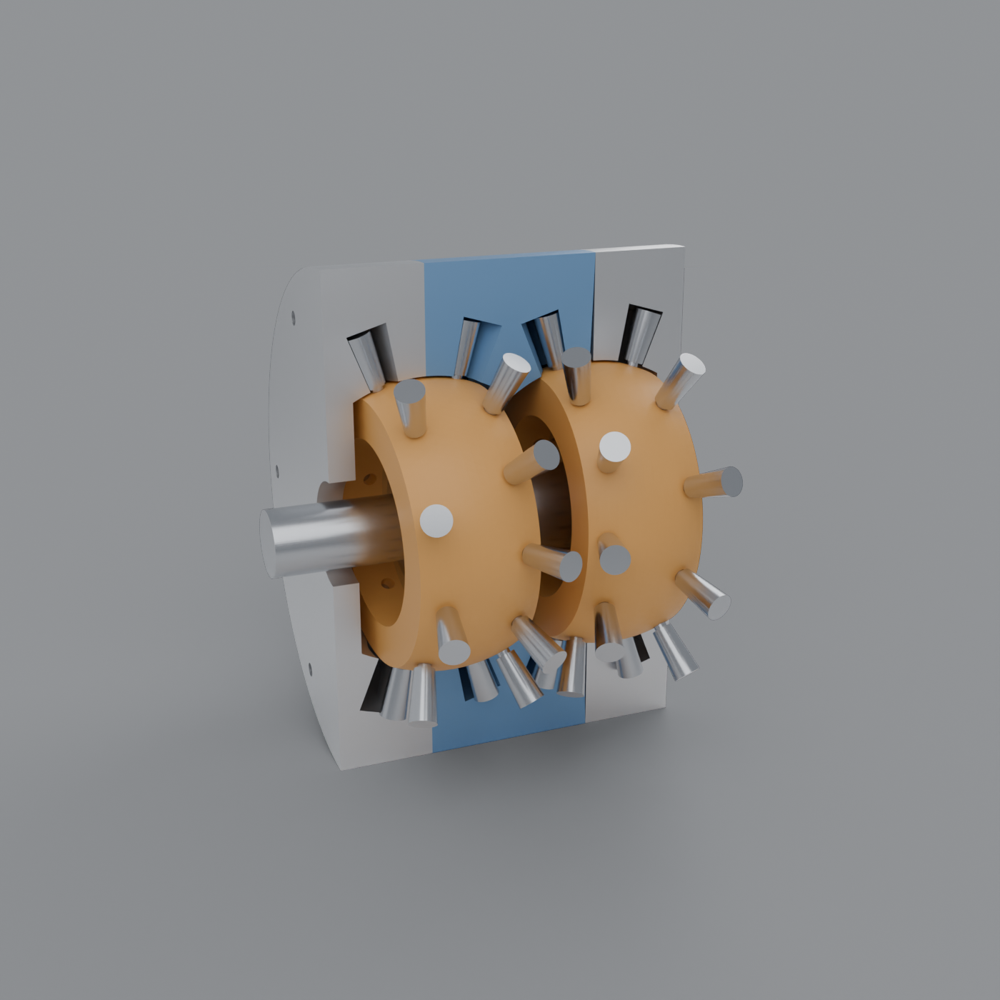
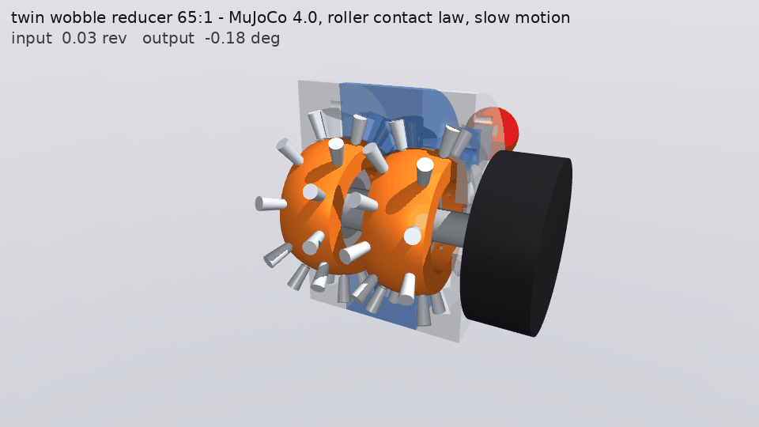

# Wobble: a nutating roller-cam reducer whose cam rollers are the output bearing

A precessing ("wobble") reducer of the kind TDI showed as a coaxial roller-cam reducer
([post](https://x.com/yeokch/status/2119347783023088106),
[Nikkei xTECH](https://xtech.nikkei.com/atcl/nxt/column/18/03727/102500008/)): zero backlash,
8:1 to 200:1. It belongs to Bostan's family of precessional transmissions. The question here: can
the cam rollers also be the actuator's main bearing, the way a crossed roller bearing carries thrust
both ways, radial load and moment?

**Short answer: not with one nutating block, yes with two.**



## The mechanism

- **The block.** It nutates about a fixed point, tilted θ = 2.5°, with the tilt direction turning
  with the input shaft.
- **The rollers.** Two rows on radial stems, conical with their apex at the nutation centre. Each
  runs in a wavy groove (a spherical cycloid) cut in a ring around the block:
  - the fixed row: 11 lobes, 10 rollers
  - the output row: 13 lobes, 12 rollers
- **The ratio:** i = z₂z₄ / (z₂z₄ − z₁z₃) = −65. TDI's 196:1 is 15/14 with 13/14.
- **The crossed-roller trick.** A roller in a closed groove would touch both walls and skid.
  Alternate rollers sit 1.2° below and above the row's cone, so A rollers ride only the lower
  wall and B rollers only the upper wall. That is how a crossed roller bearing avoids skid, by
  alternating its rollers. Each roller rolls on one surface, the row pushes both ways, and a few
  µm of interference preloads the set to zero backlash.

## What the model found (`design.py`)

### 1. One block can't locate its output

Each roller row leaves exactly one motion free: its own conjugate rolling.
- For the fixed row, that motion is the drive, and the input holds it.
- For the output row, it is a coupled tilt-and-spin wobble of the output ring about the nutation
  centre, and nothing holds it.

Under torque, the output wants to wobble along with the block. Stopping it takes a tilting moment
of T / (z₄ sin θ), about 1.76 × the output torque. So a one-block design still needs a real main
bearing, and a stiff one. With a radial bearing 25 mm off-centre, the output's torsional stiffness
falls to 1.75×10³ N·m/rad.

### 2. Two blocks tilted opposite lock it

A mirrored second block's output wobble has the same spin but the opposite tilt. The output can't
follow both, so the rollers alone hold it. Mirroring also puts both output rows in the middle,
which gives a clevis joint:

```
fixed ring | output | output | fixed ring
```

The output ring has no bearing of its own. Capacities are the worst case over input phase, at
1500 MPa contact pressure (gear practice for long life), with rollers at R = 40 mm:

| Quantity | Twin wobble (rollers only) | HPF-25 crossed roller (80 mm pitch circle) |
|---|---|---|
| Output torque | 81 N·m | (the drive) |
| Axial, each way | 4.3 kN | C = 11.4 kN (dynamic rating) |
| Tilting moment | 104 N·m | 410 N·m allowable |
| Radial | 1.1 kN | |
| Tilt stiffness | 1.49×10⁶ N·m/rad | 3.79×10⁵ N·m/rad |
| Torsional stiffness | 6.5×10⁴ N·m/rad | |
| Radial stiffness | 26 N/µm | |

The rollers give about 4× the crossed roller's tilt stiffness, because the two rows are spread
40 mm apart axially. They give about a quarter of its moment capacity, because they are small.

### 3. The rollers are small

Roller radius must stay under the groove crest's curvature radius, which is about R/(z²θ), or the
wall cusps. The flank angle is about atan(zθ). Fewer lobes allow fatter rollers but give a flatter
flank (more thrust per unit torque). Here the rollers are Ø5.5 mm at R = 40, against an undercut
limit of Ø7.7 on the output row. The flanks are 27–31°.

### 4. Efficiency is the cost

The 65:1 is a differential of two ~10:1 stages, so power circulates. Roller friction loss scales
roughly as i/2 · μ of the output work, as in a Wolfrom planetary. The preload drag does not shrink
with load. Forward efficiency:

| Preload, roller friction | 10 N·m | 40 N·m | 80 N·m |
|---|---|---|---|
| 50 N, needle rollers (μ 0.004) | 78% | 81% | 81% |
| 50 N, plain stems (μ 0.016) | 47% | 52% | 52% |
| 150 N, needle rollers | 61% | 79% | 81% |
| 150 N, plain stems | 28% | 49% | 51% |

To be efficient this needs rollers on needle bearings and a light preload. The single-stage
version would do much better: output coupling 1:1, ratio ~10, the "thin QDD" TDI plans.

### 5. The twin cancels shaking

The opposed nutations cancel the rotating inertia moment, as two-disc cycloids do. At 3000 rpm the
frame moment is 0.004 N·m rms for the twin, against 1.03 N·m for one block.

## CAD (`cad.py`, `render.py`)

**Parts:**
- two end housings, each carrying a fixed ring
- the output ring with a lug
- two blocks (the second is the mirror image)
- 44 rollers with stems
- the input shaft, with two journals tilted ±θ
- a clevis frame and a motor stand-in
- bought parts: 6806 wobble bearings and 6802 input-shaft bearings

**Groove walls.** These are the spherical offsets of the roller paths, extruded radially through
the nutation centre. They are cut with a mesh boolean (manifold3d), because a periodic ruled wave
with a 1 mm crest radius needs about 3000 stations.

**Checks** (in `out/cad/parts.json`):
- Every part is one watertight body.
- At 5 input angles, all 220 roller placements touch their wall within 30 µm. The worst overlap is
  3.5×10⁻⁶ mm³.
- The blocks clear the rings at every angle.

**Mass.** The total is 5.1 kg, and the solid steel output ring alone is 2.2 kg. The ring should
become aluminium with hardened race inserts.

## MuJoCo 4.0 simulation (`sim.py`, `demo.py`)

**How it's modelled.**
- The blocks and the output ring are free bodies, and the output has no bearing.
- MuJoCo can't collide a roller with a concave wavy groove (it would use the groove's convex hull),
  so the roller contact is a custom force law, as the mujoco-sim skill describes. Each step, for
  all 44 rollers, it evaluates:
  - roller approach from the bodies' deviation from their conjugate poses, using the same groove
    geometry as the CAD
  - Palmgren line-contact force with damping
  - rolling friction
- The forces are applied through `xfrc_applied`.
- The motor is current- and voltage-limited.
- The step is 5 µs. The highest contact mode is 19 kHz.
- Forces are computed between `mj_step1` and `mj_step2`. A plain `mj_step` leaves `xpos` one step
  stale, and the stale stiff force goes unstable inside the stability limit.

**Results** (in `out/sim_demo.png`, `out/sim.json`):

| Check | Result |
|---|---|
| Ratio | 65.001 measured vs 65.000 expected |
| Statics vs `design.solve` (input locked) | roller loads within 6 N of 304 N (selftest) |
| Hold: 8 kg at 0.4 m, 0.1 m off-plane (34.5 N·m torque, 7.9 N·m tilt moment, 102 N radial), no output bearing | 0.12 arcmin tilt vs 0.11 predicted; peak 1089 MPa |
| A/B, one block with no bearing | arm falls (38° in 150 ms) |
| A/B, one block with a crossed-roller main bearing | holds |
| A/B, twin | holds |
| Efficiency | 100.0% frictionless (check); 33.3% at μ 0.02 and 16.5 N·m vs 32.6% from the model |
| No-load drag (150 N preload, μ 0.02) | 0.5 N·m at the input |
| Shaking at 3000 rpm | twin 0.004 N·m rms; one block 1.03 N·m |



## Run

```bash
make wobble                # kinematics, roller-bearing statics, capacities, efficiency
make wobble-cad            # meshes + checks
make wobble-render         # Blender, full and cutaway
make wobble-sim-selftest   # build, hold a load, compare with design.solve
make wobble-sim-demo       # scenarios -> plots + gif (~3 min)
make wobble-sim            # interactive viewer (slow motion; the slider sets the output target)
```

## Not done yet, and caveats

**Geometry and CAD**
- **Assembly.** The rollers are captured in closed grooves, so each ring has to split at its groove
  (as a crossed roller's outer ring does). The split and its fasteners aren't designed.
- **The wobble bearing** is modelled as holding only the block's tilt direction. A real ball
  bearing also locates the block radially, so it needs radial float or it fights the rollers.
- **Rollers and stems.** The rollers are uncrowned line contacts, and the contact law ignores edge
  stress. Stem compliance is lumped as a second contact in series. The Ø3 stems are small.

**Analysis**
- **Contact model.** The 1500 MPa limit is gear practice, not a fatigue analysis of this contact.
- **Friction.** μ is assumed (0.004 for needle rollers, 0.016 for plain stems) and needs measuring.
- **Unsettled hold.** In the hold run the arm's torsional mode is still ringing at 250 ms. The
  ringing comes from the peak roller load, which reads 802 N against 694 N static.

**Not checked against hardware.** There is no test hardware. TDI's actual internals aren't public.
