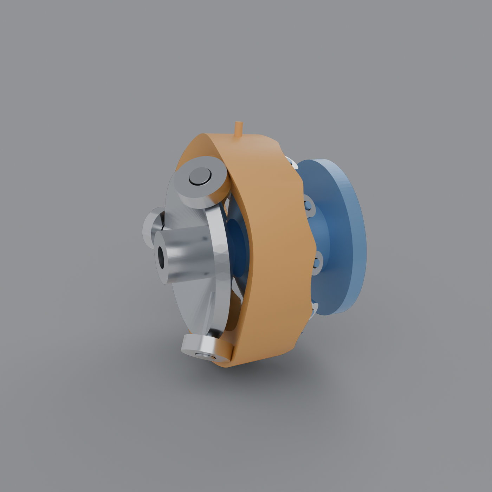
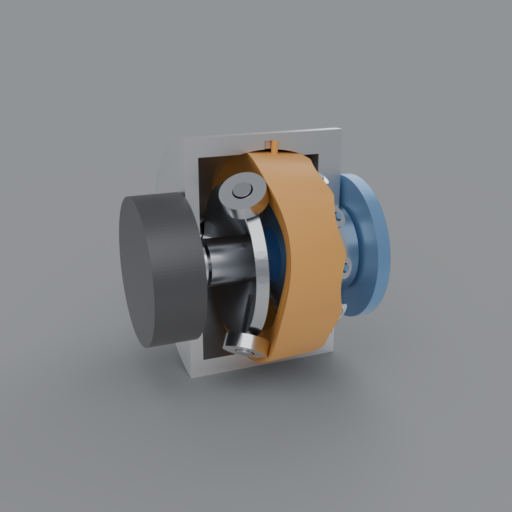
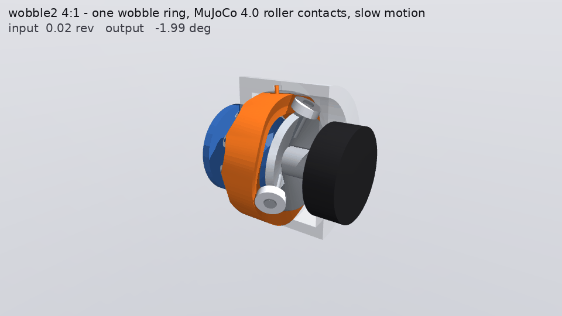

# wobble2: one wobble ring between two rows of off-the-shelf rollers

A single-disc version of [`wobble/`](../wobble/), from a sketch:
- **Input.** A disc on the input shaft carries bearings rolling on a wave cut in one end of a ring.
- **Ring.** The ring is a band cut from a sphere, so it rocks as the waves pass. Its other end
  carries a second wave, clocked 30° from the first.
- **Output.** The second wave drives the output's ring of similar bearings around.

The design work turned up four things the sketch needs.



## How it works (`design.py`)

**The ring nutates without spinning.** It sits in a spherical seat and two pins keep it from
turning. A rigid, non-spinning ring tilted θ can only present a first-harmonic height change,
Rθ·cos(α − ψ). A wave of N lobes cancels that change for a roller at angle α when ψ = (1 ∓ N)α.
It does so for every roller spaced 2π/(N ∓ 1) apart. So Z rollers on a wave of N = Z ± 1 lobes
nutate the ring Z times per turn of their carrier, and the faces are conjugate with every
roller.

**What the sketch needs:**

1. **The ratio is a roller count.** The two waves need different lobe counts. With the same count,
   a 30° clocking gives 1:1, a coupling. The ratio is i = (s_o Z_o) / (s_i Z_i), like a gear pair.
   The clocking (`back_clock`, kept at 30°) only sets the timing.
2. **The ring must not spin.** If it could spin, torque balance would force input torque to equal
   output torque. Pins in the seat carry the reaction.
3. **The pins must be a constant-velocity coupling.**
   - A pure nutation never rotates about the bisector of the housing axis and the ring axis (the
     CV-joint plane), so the pins hold that rotation.
   - Two pins in straight axial slots act as a Cardan joint. That forces a θ² spin ripple of about
     17 µm at the faces, several times the preload.
   - The slots need a slight figure-8 curve. In the CAD the slots are cut as the pins' swept volume
     over a nutation cycle.
   - Holding world z by mistake costs 0.85% of the torque in the virtual-work check. That check is
     exact once the constraint is on the bisector.
4. **Two input bearings don't work; three do.**

   | Input bearings | Drive conditioning, worst/best over a turn | Output rollers unloaded at preload |
   |---|---|---|
   | 2, 180° apart (3-lobe wave) | 0.000: dead centre every 60° | 0/12 |
   | 2, 120° apart (4-lobe wave) | 0.62 | 9/12 (lopsided) |
   | **3, 120° apart (4-lobe wave)** | **0.97** | **0/12** |

   - Two rollers 180° apart can't resist the ring tilting about the line through them. Every 60° of
     input, that tilt lines up with the output's rolling, and the input loses the drive, like the
     dead centre of a one-cylinder crank.
   - At 120° they push the ring on one side only.

**The rollers.**
- Bearings are cylinders, not cones, so the faces are offset at each radius along the bearing by
  asin(D/2ρ) and aren't quite ruled through the centre. That costs a slip of about ±B/(2R) across
  the bearing width.
- The ring floats axially in its seat, so the two rows squeeze it and share the preload.

## The design

| | |
|---|---|
| Ratio | **−4:1** (3 input bearings, 4-lobe front wave; 12 output, 11-lobe back wave) |
| Nutation | θ = 1.8°, 3× input speed |
| Pitch sphere | R = 55 mm (bearing mid-planes) |
| Input rollers | 3 × 6000-2RS (10×26×8, C 4.75 kN, C0 1.96 kN) |
| Output rollers | 12 × IKO CF4R stud cam followers (Ø12×8, crowned, C 2.07 kN, C0 1.59 kN) |
| Flanks | front 7.2°, back 19.2°; roller radius 6.0 against an 8.8 mm crest limit |
| Torque capacity | **37.5 N·m** (input bearings at C0) |
| Efficiency (model) | 86% at 2 N·m, 92% at 5, 93.5–94% from 10 N·m up |
| Life at 3000 rpm input, 10 N·m | input L10 1900 h, output L10 16,500 h |
| Housing | Ø144; about 4.1 kg with a steel ring (1.2 kg) and aluminium housing |

**Options.** `design.py --sweep` lists every option that keeps the crest radius at least 1.25× the
roller radius. With three input slots the ratio runs from about 2.7:1 to 5.3:1. The ceiling is set
by how many rollers fit on the back wave before it cusps. This is a QDD-class reducer, not a
high-ratio one.

**The weak point is the input wave.** It is shallow, at about atan(4θ). The three input bearings
carry about 7× the tangential force as axial load, at 12,700 rpm when the input runs at 3000 rpm.
Bigger input bearings (6201 and up, or cam followers) would raise capacity; the front wave has
plenty of room, with a 52 mm crest limit against a 13 mm roller.

## CAD (`cad.py`, `render.py`)

**Parts:**
- the ring, with two pins
- two housing halves, split at the equator to trap the ring's spherical band
- the input carrier, with three studs
- the output carrier, with twelve studs and an output flange
- the input shaft
- stand-ins for the motor and the bearings

The wave faces and the ring are a mesh (manifold3d booleans, about 2900 azimuth stations).
Everything else is B-rep.

**Checks** (in `out/cad/parts.json`):
- Every part is one watertight body.
- At 5 input angles, all 75 roller placements touch their wave within 30 µm. The worst overlap is
  5×10⁻⁶ mm³.
- There are no clashes between ring, housings, carriers, shaft and rollers at any of those angles,
  and the pins clear their slots.



## MuJoCo 4.0 simulation (`sim.py`)

**How it's modelled.**
- **Joints:**
  - the input is a hinge, driven by a current- and voltage-limited motor stand-in
  - the ring is a ball joint for the seat, on a light axial slide for the seat's float
  - the output is a hinge on its main bearing
- **Roller contacts:** the 15 contacts are a custom force law, as in wobble: the face geometry from
  `design.py`, Palmgren line contact, damping and rolling friction.
- **Pins:** a constraint on the bisector, with sliding friction.

**Results** (in `out/sim_demo.png`, `out/sim.json`):

| Check | Result |
|---|---|
| Ratio | −4.000 measured vs −4.000 |
| Statics vs `design.solve` (selftest, input locked, 10.3 N·m) | roller loads within 30 N of 596 N; motor 2.580 N·m vs 2.584 expected |
| Hold with the output servo | settles at 595 N peak roller load vs 592 predicted |
| Efficiency at 10 N·m, dyno load | 94.2% at 190 rpm in, 94.1% at 3000 rpm; model 93.5% |
| **Shaking at 3000 rpm input** | **49 N·m rms** (wobble1: twin 0.004, one block 1.03) |



## The catch: shaking

The ring nutates at 3× input speed, and its rocking moment grows with the square of that:
M ≈ I_t · θ · (Z_i · ω_in)². A hand estimate gives about 50 N·m for this 1.2 kg steel ring at
3000 rpm; the sim measures 49. It falls with the square of input speed: about 5 N·m at 1000 rpm.

Ways out, roughly in order of how much they change the design:

| Fix | Effect |
|---|---|
| Lighter ring (aluminium, or printed with inserted races) | about ÷3 for aluminium |
| Smaller θ | ∝ θ |
| Run the motor slower | ∝ speed² (but that defeats a 4:1 QDD) |
| A second ring nutating opposite | wobble1's twin, which cancels it |

An input-speed balancer can't cancel it, because the ring's moment turns at −3× input speed.

## Run

```bash
make wobble2                # kinematics, dead-centre check, capacity, life, efficiency
make wobble2-cad            # meshes + checks
make wobble2-render         # Blender: full, cutaway, ring with its rollers
make wobble2-sim-selftest   # build, hold a load, compare with design.solve
make wobble2-sim-demo       # ratio, hold, efficiency vs speed, shaking -> plots + gif
make wobble2-sim            # interactive viewer (slow motion; the slider sets the output target)
```

## Not done yet, and caveats

- **Pins:** the pin slots are swept, not drawn. Making the CV slots (or a ball-groove coupling) needs
  a real drawing.
- **Housing split:** the housing halves need bolts and an alignment spigot.
- **Main bearing:** the output carrier's main bearing (a 61808 pair as a stand-in) takes the squeeze
  and any output moment. It isn't sized.
- **Ratings:** bearing ratings come from distributor listings (SKF/FAG/IKO); check the exact
  suffix.
- **Model scope:**
  - the slip across the bearing width isn't modelled
  - the pins are modelled as a stiff constraint plus μ 0.12 sliding friction, and seat friction is
    left out
  - contact pressure uses 1500 MPa as the long-life limit

## Interactive page (`web_export.py`)

`make wobble2-web` writes `web/parts.gltf.json` and `web/meta.json` for `web/index.html`: slide to fit
the 11 assembly steps in order, and run the reducer at any point (the ring nutates, the output turns
at −1/4). Serve it with `python -m http.server -d wobble2/web` and open http://localhost:8000.
